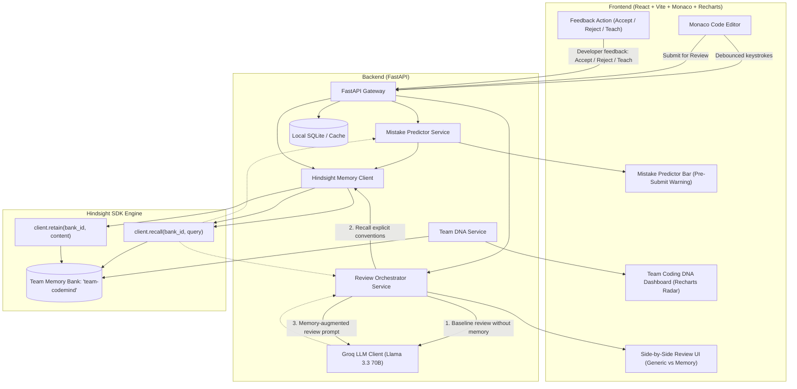

# 🧠 CodeMind AI — Self-Learning Code Review Agent

[](https://js-chinmayaojaswi.github.io/codemind-ai/)
[](https://github.com/js-chinmayaojaswi/codemind-ai)

> 🌐 **Live Website & Studio URL**: [**https://js-chinmayaojaswi.github.io/codemind-ai/**](https://js-chinmayaojaswi.github.io/codemind-ai/)

---

[](https://python.org)
[](https://fastapi.tiangolo.com)
[](https://react.dev)
[](https://typescriptlang.org)
[](https://groq.com)
[](https://github.com/hindsight-ai/hindsight)
[](https://tailwindcss.com)

> **CodeMind AI** is a self-learning code review agent that eliminates LLM amnesia. Powered by explicit agent memory via the **Hindsight SDK** and sub-second inference on **Groq Llama 3.3 70B**, it retains past postmortems, prevents recurring anti-patterns as you type, and cultivates an evolving **Team Coding DNA**.

---

## ⚡ Why CodeMind AI?

Stateless AI code reviewers suffer from chronic amnesia: they generate dozens of nitpicks about missing docstrings while approving code that starves asyncio event loops or violates transaction boundaries. 

CodeMind AI solves this with **explicit agent memory primitives**:
1. **Pre-Submit Mistake Prediction**: Intercepts recurring anti-patterns in the Monaco Editor before code is ever committed to Git.
2. **Memory-Powered Review Comparison**: Dual-pane A/B evaluation proving the concrete difference between generic stateless LLM suggestions and Hindsight memory-augmented reviews.
3. **Team Coding DNA**: Dynamic multi-axis radar chart (Concurrency, Security, Architecture, Resilience, Contracts, Testing) scoring team adherence and exportable as JSON.
4. **Continuous Learning Loop**: 1-click developer feedback (`Accept`, `Reject with Reason`, `Teach Convention`) triggers Hindsight `retain()`, updating the organizational memory bank forever without fine-tuning.

---

## 🏗️ Architecture & Data Flow



---

## 🚀 Quick Start

### 1. Prerequisites
- Python 3.11+
- Node.js 18+ & npm
- [Groq API Key](https://console.groq.com) (optional for simulation fallback mode)
- [Hindsight Client](https://pypi.org/project/hindsight-client/)

### 2. Run with One-Click Launcher (Windows PowerShell)
```powershell
.\run_demo.ps1
```

### 3. Manual Installation

#### Backend Setup
```bash
cd backend
python -m venv .venv
# Windows:
.venv\Scripts\activate
# Linux/macOS:
source .venv/bin/activate

pip install -r requirements.txt
cp .env.example .env
uvicorn app.main:app --host 127.0.0.1 --port 8000 --reload
```
API Documentation will be available at: `http://localhost:8000/docs`

#### Frontend Setup
```bash
cd frontend
npm install
npm run dev
```
Dashboard & Website will be available at: `http://localhost:5173`

---

## 🧪 Automated Testing

Run the full test suite across Groq Llama 3.3 integration, Hindsight pipelines, endpoints, and standout features:

```bash
backend\.venv\Scripts\python -m pytest backend/tests -v
```

All 19 tests pass cleanly:
- `test_groq_service.py`: JSON extraction, temperature tuning, dual-prompting.
- `test_hindsight_pipeline.py`: Query formulation, `retain` operations, `recall` operations.
- `test_services.py`: FastAPI endpoints, health checks, SQLite database persistence.
- `test_standout_features.py`: Team Coding DNA radar synthesis, mistake prediction patterns, and continuous feedback loop.

---

## 📁 Repository Structure

```
codemind-ai/
├── backend/
│   ├── app/
│   │   ├── api/            # API endpoints (reviews, feedback, dna, health)
│   │   ├── models/         # Pydantic & SQLAlchemy domain models
│   │   ├── services/       # Groq, Hindsight, Predictor, and DNA services
│   │   ├── config.py       # Pydantic Settings
│   │   ├── database.py     # SQLAlchemy session & DB initialization
│   │   └── main.py         # FastAPI application entrypoint
│   ├── tests/              # Pytest test suite (19 tests)
│   ├── requirements.txt    # Python dependencies
│   └── .env.example
├── frontend/
│   ├── src/
│   │   ├── components/     # Monaco editor, radar chart, review cards, feedback bar
│   │   ├── views/          # Landing page, Review Studio, A/B Comparison, Team DNA, History
│   │   ├── services/       # API client & anti-pattern presets
│   │   ├── types/          # TypeScript domain interfaces
│   │   ├── App.tsx         # Main application controller
│   │   └── main.tsx        # React root mount
│   ├── package.json
│   ├── vite.config.ts
│   └── tailwind.config.js
├── demo_scenarios/         # Production anti-pattern test cases
├── docs/
│   ├── ARCHITECTURE.md     # Complete system specification
│   ├── MEMORY_PIPELINE.md  # Hindsight Retain & Recall deep dive
│   └── DEMO_GUIDE.md       # Step-by-step walkthrough & pitch script
└── run_demo.ps1            # Single-click launcher
```

---

## 📜 License
Apache-2.0 License.
