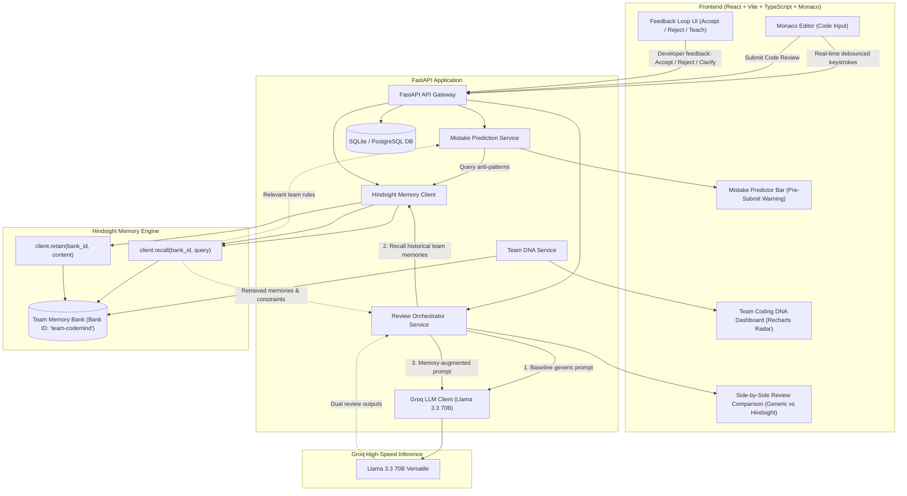

# CodeMind AI — System Architecture & Specification

## 1. Executive Summary
**CodeMind AI** is a self-learning code review agent designed to transcend the limitations of stateless, generic AI code reviewers. While standard LLMs hallucinate nitpicks or suggest generic PEP8/style rules that conflict with real-world enterprise engineering culture, CodeMind AI develops an evolving **Team Coding DNA** using **explicit agentic memory via the Hindsight SDK**.

By leveraging Hindsight's `recall` and `retain` primitives:
1. **Pre-Submission Mistake Prediction**: As developers type, CodeMind recalls historical anti-patterns and warns them before code is ever submitted to pull request.
2. **Context-Augmented Review**: CodeMind queries the team's memory bank to critique PRs against historical precedent, architectural decisions, and rejected patterns.
3. **Continuous Learning Loop**: Every developer interaction (accepting, rejecting, or correcting a review suggestion) triggers a Hindsight `retain` pipeline, refining the team memory bank without manual prompt engineering.

---

## 2. End-to-End System Architecture



---

## 3. Complete Project Directory Layout

```
codemind-ai/
├── backend/
│   ├── app/
│   │   ├── __init__.py
│   │   ├── main.py                      # FastAPI app entrypoint, CORS, exception handlers
│   │   ├── config.py                    # Environment settings (Groq Key, Hindsight URL/Key)
│   │   ├── database.py                  # SQLAlchemy engine, session maker, base model
│   │   ├── models/
│   │   │   ├── __init__.py
│   │   │   ├── review.py                # ReviewRequest, ReviewResponse, ReviewComparison models
│   │   │   ├── feedback.py              # ReviewFeedback schema and persistence models
│   │   │   └── team_dna.py              # TeamProfile, RuleItem, MetricSummary models
│   │   ├── services/
│   │   │   ├── __init__.py
│   │   │   ├── groq_service.py          # Groq LLM client (Llama 3.3 70B) for raw & augmented completions
│   │   │   ├── hindsight_service.py     # Hindsight SDK wrapper (explicit recall & retain operations)
│   │   │   ├── review_service.py        # Orchestration of generic vs. memory-augmented reviews
│   │   │   ├── predictor_service.py     # Proactive anti-pattern matching before submission
│   │   │   └── dna_service.py           # Synthesis of team conventions, radar metrics, and memory bank stats
│   │   └── api/
│   │       ├── __init__.py
│   │       ├── reviews.py               # Endpoints: /api/reviews/analyze, /api/reviews/predict
│   │       ├── feedback.py              # Endpoint: /api/feedback (submits feedback to Hindsight retain)
│   │       ├── dna.py                   # Endpoint: /api/dna (retrieves Team Coding DNA metrics & rules)
│   │       └── health.py                # Endpoint: /api/health (status of Groq & Hindsight connectors)
│   ├── tests/
│   │   └── test_services.py             # Unit tests for services and pipeline verification
│   ├── requirements.txt                 # Backend dependencies
│   ├── .env.example                     # Sample backend environment configuration
│   └── README.md
│
├── frontend/
│   ├── public/
│   │   └── favicon.ico
│   ├── src/
│   │   ├── assets/
│   │   ├── components/
│   │   │   ├── layout/
│   │   │   │   ├── Sidebar.tsx          # Modern dark sidebar with active views navigation
│   │   │   │   └── Header.tsx           # Status header, active team bank selector, health indicator
│   │   │   ├── editor/
│   │   │   │   ├── MonacoCodeEditor.tsx # High-performance Monaco editor with syntax highlighting
│   │   │   │   └── MistakeWarningPill.tsx # Floating real-time warning pill driven by memory prediction
│   │   │   ├── review/
│   │   │   │   ├── ReviewComparison.tsx # A/B side-by-side view (Generic LLM vs Memory-Augmented LLM)
│   │   │   │   ├── ReviewCard.tsx       # Individual review item card with Hindsight provenance citation
│   │   │   │   └── FeedbackBar.tsx      # Thumbs up/down, reject reason, and 'Teach Team Memory' modal
│   │   │   ├── dna/
│   │   │   │   ├── TeamDnaRadar.tsx     # Interactive Recharts Radar visualization of team style
│   │   │   │   └── RuleList.tsx         # Chronological and ranked list of learned explicit rules
│   │   │   └── stats/
│   │   │       └── MetricCards.tsx      # Top-level KPI cards (Accuracy, Retained Rules, Prevented Bugs)
│   │   ├── views/
│   │   │   ├── DashboardView.tsx        # Main code review workspace
│   │   │   ├── ComparisonView.tsx       # Side-by-Side proof of Hindsight value
│   │   │   ├── TeamDnaView.tsx          # Team profile, learned rules & conventions
│   │   │   └── HistoryView.tsx          # Historical reviews and learning log
│   │   ├── services/
│   │   │   └── api.ts                   # Type-safe Axios client connecting to FastAPI backend
│   │   ├── types/
│   │   │   └── index.ts                 # Full TypeScript typings for reviews, feedback, DNA, and memory
│   │   ├── App.tsx                      # Root application component with routing & state management
│   │   ├── index.css                    # Tailwind CSS configuration, dark tokens, scrollbar styling
│   │   └── main.tsx                     # Vite React root mounting
│   ├── package.json                     # Frontend dependencies (React, Monaco, Lucide, Recharts, Tailwind)
│   ├── tsconfig.json
│   ├── vite.config.ts
│   └── tailwind.config.js
│
├── docs/
│   ├── ARCHITECTURE.md                  # This file
│   └── MEMORY_PIPELINE.md               # Deep dive into Hindsight retain/recall data schemas
└── README.md
```

---

## 4. Key Subsystem Specifications

### Subsystem A: Hindsight Persistent Memory Integration
* **Package**: `hindsight-client`
* **Bank ID**: `team-codemind`
* **Operation 1: `retain(bank_id, content)`**:
  - Triggered when a team lead or developer accepts/rejects a review with a reason, or seeds a convention (e.g., *"We always use async SQLAlchemy sessions; never call session.commit() directly in route handlers"*).
  - Hindsight extracts the fact, creates the graph/temporal index, and stores it in the team bank.
* **Operation 2: `recall(bank_id, query)`**:
  - Triggered during review submission and real-time mistake prediction.
  - Returns retrieved knowledge chunks and citations to inject into the Groq prompt context.

### Subsystem B: Groq High-Speed Inference Engine
* **Model**: `llama-3.3-70b-versatile`
* **Speed Profile**: ~250 tokens/sec, enabling sub-second dual-generation for side-by-side comparison without lag.
* **Dual Execution Pipeline**:
  - Run 1 (Generic Baseline): System prompt has standard PEP8/clean code rules without team memory.
  - Run 2 (Hindsight-Augmented): System prompt is injected with explicit Hindsight-recalled team rules.

### Subsystem C: The 3 Standout Features
1. **Team Coding DNA**:
   - Synthesizes team strengths, architectural preferences, and forbidden patterns into a dynamic radar chart and searchable rule catalog.
2. **Memory-Powered Review Comparison**:
   - Split-screen comparison proving the difference: Generic AI generates surface-level boilerplate critique; Hindsight-augmented AI flags critical team architectural anti-patterns with rule citations.
3. **Mistake Prediction**:
   - Real-time debounced typing query that checks current AST/code fragment against recalled high-frequency team mistakes and presents a subtle warning badge before submission.
